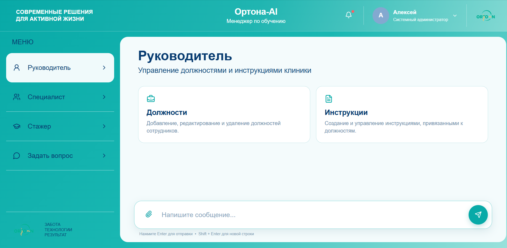
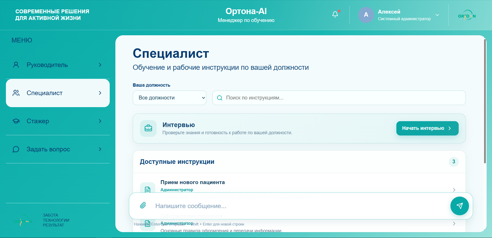
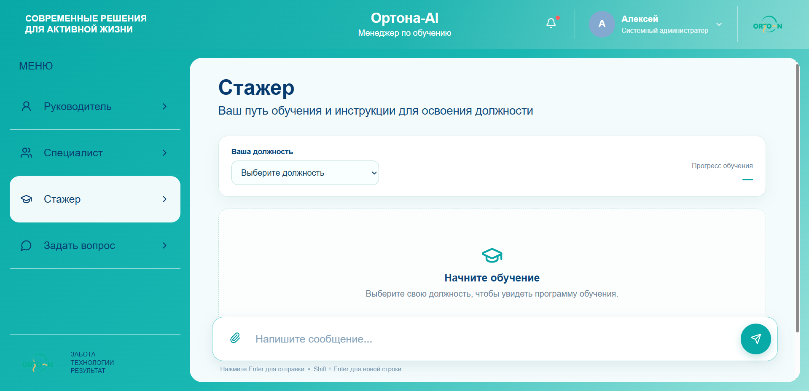
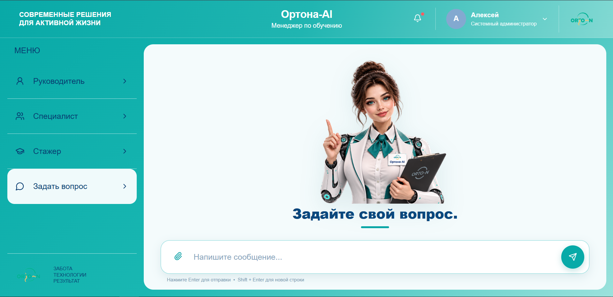

# Ортона-AI — AI-платформа для сохранения и передачи экспертных знаний

**От практического опыта сотрудников — к понятным процессам, инструкциям и обучению.**

Ортона-AI помогает компаниям собирать знания опытных специалистов, превращать их в структурированные рабочие процессы и использовать эти знания для подготовки и обучения сотрудников.

🌐 **Веб-приложение:** [app.orto-n.ru](https://app.orto-n.ru)



## Какую проблему решает продукт

В любой компании есть сотрудники, которые знают, как на самом деле выполняется работа. Но эти знания часто остаются в личном опыте, устных объяснениях и разрозненных документах.

Ортона-AI помогает превратить такой опыт в понятную и пригодную для повторного использования систему знаний.

## Как это работает

```text
Опытный специалист
        ↓
   AI-интервью
        ↓
   Process JSON
        ↓
   Рабочая инструкция
        ↓
   Обучение сотрудника
        ↓
   Проверка знаний
```

В основе продукта — **Process JSON**, единая структурированная модель процесса. На её основе формируются инструкции и тесты. Это помогает сохранять согласованность материалов и не поддерживать несколько независимых описаний одной и той же работы.

## Что уже реализовано

### AI-интервью и работа с экспертными знаниями
- Диалог со специалистом для последовательного извлечения практического опыта.
- Адаптивные уточняющие вопросы.
- Текстовые и голосовые ответы с транскрибацией.
- Работа с иллюстративными материалами.
- Формирование и сохранение Process JSON.

### Создание рабочих инструкций
- Генерация инструкции на основе структурированного процесса.
- Хранение процессов и материалов.
- Работа с инструкциями в разрезе должностей.

### Обучение и проверка знаний
- Доступ к инструкциям в соответствии с должностью.
- Отметка изученных материалов и сохранение прогресса.
- Формирование тестов на основе Process JSON.
- Сохранение результатов попыток.
- Просмотр результатов обучения руководителем.

### Ролевые кабинеты
В приложении предусмотрены три пользовательских контура:

| Роль | Возможности |
|---|---|
| Руководитель | Управление должностями и пользователями, работа с инструкциями, просмотр результатов обучения |
| Специалист | AI-интервью, описание процессов, подготовка и сохранение инструкций |
| Стажёр | Изучение инструкций, прохождение тестов, отслеживание прогресса |

## Скриншоты приложения

| Кабинет руководителя | Кабинет специалиста |
|---|---|
|  |  |

| Кабинет стажёра | Работа с вопросами |
|---|---|
|  |  |

## Архитектура и технологии

Ортона-AI — полноценное веб-приложение с отдельными frontend, backend, базой данных и слоем AI-автоматизации.

| Компонент | Технологии | Назначение |
|---|---|---|
| Web UI | React 19, Vite, JavaScript | Пользовательские кабинеты и сценарии |
| Backend | Python, FastAPI | API и серверная логика |
| База данных | PostgreSQL | Хранение пользователей, процессов, интервью и результатов |
| AI и автоматизация | OpenAI API, n8n | AI-интервью, обработка и генерация материалов |
| Инфраструктура | Docker, Ubuntu Server, Caddy | Развёртывание и публикация приложения |

### Общая схема

```text
React / Vite
     │
     ▼
 FastAPI ───────── n8n ───────── OpenAI API
     │
     ▼
 PostgreSQL
```

## Что было сделано в проекте

Проект охватывает полный цикл создания цифрового продукта:

- Проработка бизнес-задачи и пользовательских сценариев.
- Проектирование архитектуры и модели данных.
- Создание веб-интерфейса на React.
- Разработка backend и REST API на FastAPI.
- Интеграция AI-моделей и автоматизаций.
- Работа с PostgreSQL и структурированными данными.
- Развёртывание приложения в Docker на сервере.
- Подключение домена и HTTPS.
- Проверка пользовательских сценариев в production.

## Текущий статус

Основные контуры руководителя, специалиста и стажёра реализованы и проверены в работающем приложении.

**Следующее направление развития** — подключение полноценной корпоративной базы знаний и развитие поиска по документам (RAG). Эта часть зависит от подготовки и подключения источника корпоративных данных и не заявляется как завершённая функция.

## Структура репозитория

```text
backend/       Backend на FastAPI
frontend/      Веб-приложение React
sql/           SQL-схема базы данных
workflows/     AI-workflows n8n
prompts/       Промпты AI-агентов
docs/          Скриншоты и описание продукта
deploy.ps1     Скрипт развёртывания
```

## Запуск frontend локально

```bash
cd frontend/ortona-ai
npm install
npm run dev
```

Для production-сборки:

```bash
npm run build
```

Для полноценной работы приложения также необходимы backend, PostgreSQL и соответствующие переменные окружения.

---

**Ортона-AI — пример того, как с помощью AI-инструментов, разработки и автоматизации можно пройти путь от бизнес-задачи до работающего цифрового продукта.**
